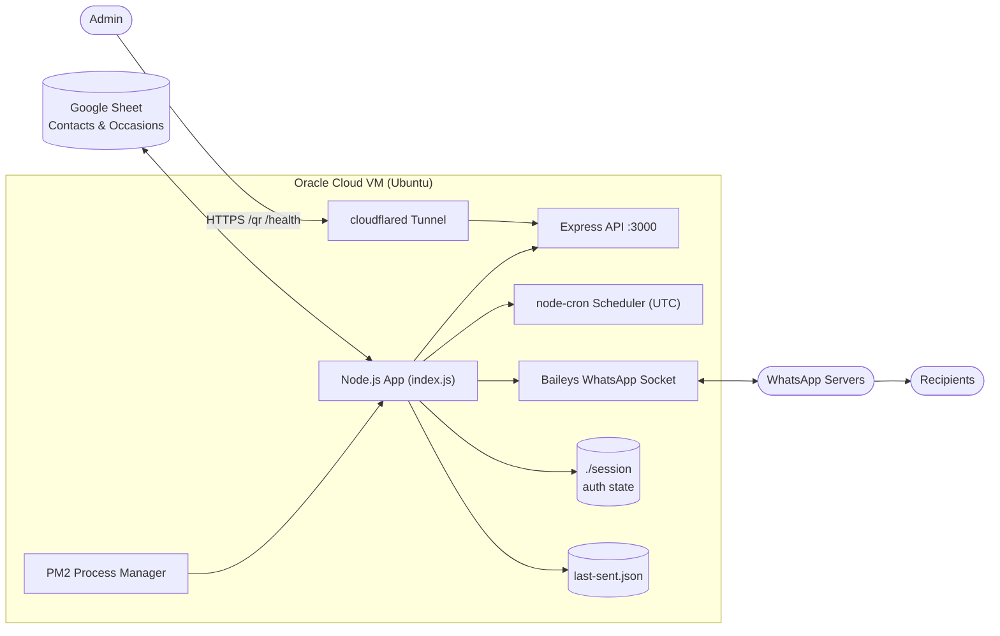
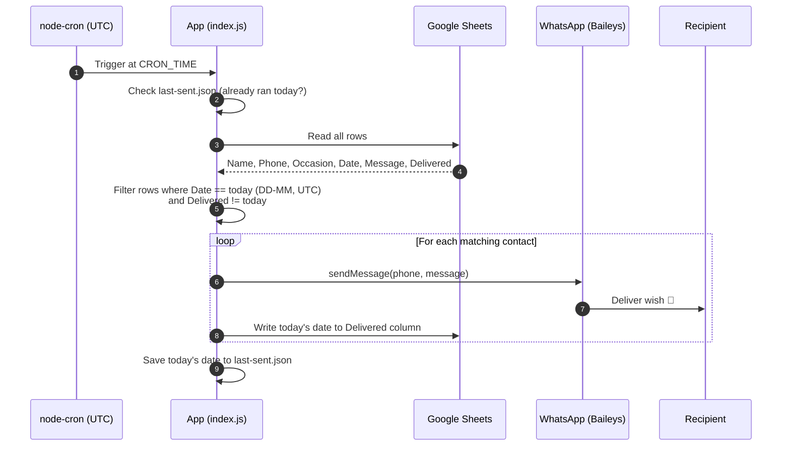
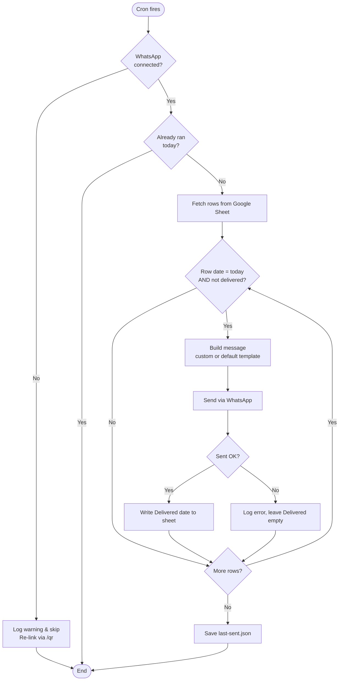

# 🎉 Wish Automation — WhatsApp Greeting Server


A lightweight Node.js server that **automatically sends birthday, anniversary, and custom occasion wishes on WhatsApp**. Contacts and occasions are managed in a **Google Sheet**; the server checks the sheet every day at a scheduled time (UTC), sends messages to everyone whose date matches today, and stamps the **Delivered** column so nobody receives a duplicate.

---

## 📑 Table of Contents

- [Features](#-features)
- [Architecture](#-architecture)
- [Workflow](#-workflow)
- [Tech Stack](#-tech-stack)
- [Project Structure](#-project-structure)
- [Google Sheet Format](#-google-sheet-format)
- [Getting Started](#-getting-started)
- [Configuration](#-configuration)
- [Linking WhatsApp](#-linking-whatsapp)
- [Running in Production (PM2)](#-running-in-production-pm2)
- [Public HTTPS Endpoint (Cloudflare Tunnel)](#-public-https-endpoint-cloudflare-tunnel)
- [API Endpoints](#-api-endpoints)
- [Scheduling & Timezone](#-scheduling--timezone)
- [Reliability Safeguards](#-reliability-safeguards)
- [Troubleshooting](#-troubleshooting)
- [Security](#-security)
- [Disclaimer](#-disclaimer)
- [License](#-license)

---

## ✨ Features

- 📅 **Daily scheduled sends** at an exact time using `node-cron`, pinned to **UTC**
- 📊 **Google Sheets as the data source** — no database to maintain
- ✅ **Delivery tracking** — writes the delivered date (`YYYY-MM-DD`) back to the sheet
- 🛡️ **Duplicate protection** — a contact is never messaged twice for the same day
- 💬 **Custom or default messages** — per-row message, or a built-in template per occasion
- 🔐 **Persistent WhatsApp session** — scan the QR once; reconnects automatically
- 🔁 **Auto-recovery** — PM2 restarts on crash; socket reconnects on drop
- 🌐 **Health check & QR endpoints** for monitoring and linking
- 🪶 **Low memory footprint** — runs comfortably on a ~1 GB free-tier VM

---

## 🏗 Architecture



---

## 🔄 Workflow

### Daily send cycle



### Decision flow



---

## 🧰 Tech Stack

| Layer | Technology |
|---|---|
| Runtime | Node.js 18.x |
| Web server | Express |
| WhatsApp client | [Baileys](https://github.com/WhiskeySockets/Baileys) (WebSocket, no browser required) |
| Scheduler | node-cron |
| Data source | Google Sheets API (`googleapis`) |
| QR rendering | `qrcode` |
| Process manager | PM2 |
| Public access | Cloudflare Tunnel (`cloudflared`) |
| Hosting | Oracle Cloud Always Free VM (Ubuntu) |

---

## 📁 Project Structure

```
wish-automation/
├── index.js                # Main application (server, cron, WhatsApp, Sheets)
├── ecosystem.config.js     # PM2 configuration
├── package.json
├── .env                    # Environment variables (NOT committed)
├── gcp-key.json            # Google service-account key (NOT committed)
├── last-sent.json          # Runtime state: last successful daily run
├── session/                # WhatsApp auth state (NOT committed)
└── README.md
```

---

## 📊 Google Sheet Format

The first row must contain these headers (names are matched by header, order doesn't matter):

| Name | Phone | Occasion | Date | Message | Delivered |
|---|---|---|---|---|---|
| Alice | 919876543210 | Birthday | 29-10 | | 2026-10-29 |
| Bob | 14155550123 | Anniversary | 15-03 | Happy anniversary, Bob & Priya! 💐 | |

| Column | Description |
|---|---|
| **Name** | Recipient's name (used in default templates) |
| **Phone** | Full international number, digits only, **no `+`** |
| **Occasion** | `Birthday`, `Anniversary`, or any custom text |
| **Date** | Occasion date in **`DD-MM`** format |
| **Message** | *(Optional)* Custom message. Empty → default template is used |
| **Delivered** | Auto-filled by the server with `YYYY-MM-DD` after a successful send |

> **Sheet tab name:** the server reads/writes `Sheet1`. Rename your tab accordingly or adjust the range in `index.js`.

Share the sheet with your **service account email** (found in `gcp-key.json`) with **Editor** access.

---

## 🚀 Getting Started

### Prerequisites

- Node.js **18+** and npm
- A Google Cloud project with the **Google Sheets API** enabled and a **service account** key
- A WhatsApp account/number to link as a device
- (Production) Ubuntu server with PM2

### Installation

```bash
git clone https://github.com/<your-username>/wish-automation.git
cd wish-automation
npm install
```

### Create your `.env`

```bash
cp .env.example .env
nano .env
```

### Run locally

```bash
node index.js
```

Then open `http://localhost:3000/qr` and scan the QR code.

---

## ⚙️ Configuration

All settings are read from environment variables:

| Variable | Required | Default | Description |
|---|---|---|---|
| `GOOGLE_SHEET_ID` | ✅ | — | ID from the Google Sheet URL |
| `GOOGLE_CREDS_JSON` | ✅ | — | Service-account credentials as a **single-line JSON string** |
| `CRON_TIME` | ❌ | `30 8 * * *` | Cron expression for the daily run |
| `TZ` | ❌ | `Asia/Kolkata` | Timezone for the scheduler. **Set to `UTC`.** |
| `PORT` | ❌ | `3000` | HTTP server port |

**Example `.env`**

```env
GOOGLE_SHEET_ID=1AbCdEfGhIjKlMnOpQrStUvWxYz1234567890
GOOGLE_CREDS_JSON={"type":"service_account","project_id":"...","private_key":"..."}
CRON_TIME=0 0 * * *
TZ=UTC
PORT=3000
```

---

## 📱 Linking WhatsApp

1. Start the app (`pm2 start ecosystem.config.js` or `node index.js`).
2. Open `https://<your-domain-or-ip>/qr` in a browser.
3. On your phone: **WhatsApp → Settings → Linked Devices → Link a Device**.
4. Scan the QR code within ~30 seconds (it refreshes automatically).
5. Logs will show a successful connection. The session is saved in `./session/`, so **no re-scan is needed after restarts**.

> If the device is ever unlinked from the phone, delete `./session/`, restart, and scan again.

---

## 🖥 Running in Production (PM2)

**`ecosystem.config.js`**

```js
module.exports = {
  apps: [{
    name: 'wish-bot',
    script: 'index.js',
    instances: 1,            // MUST stay 1 — never run two copies on one session
    exec_mode: 'fork',
    autorestart: true,
    max_restarts: 10,
    min_uptime: '30s',
    restart_delay: 5000,
    max_memory_restart: '400M',
    node_args: '--max-old-space-size=256'
  }]
};
```

**Commands**

```bash
pm2 start ecosystem.config.js     # first start
pm2 save                          # persist process list
pm2 startup                       # auto-start PM2 on server boot (run the printed command)

pm2 list                          # status
pm2 logs wish-bot                 # live logs
pm2 restart wish-bot              # restart
pm2 stop wish-bot                 # stop
```

> ⚠️ **Never run `node index.js` manually while PM2 is managing the app.** Two processes sharing one WhatsApp session will corrupt encryption state and cause messages to hang on *"Waiting for this message"*.

---

## 🌐 Public HTTPS Endpoint (Cloudflare Tunnel)

Useful for reaching `/qr` and `/health` over HTTPS without opening ports or configuring TLS.

**Quick tunnel** (free, random URL that changes every restart):

```bash
cloudflared tunnel --url http://localhost:3000
```

**Run it as a service so it survives logout & reboot:**

```bash
sudo tee /etc/systemd/system/cloudflared-tunnel.service > /dev/null <<'EOF'
[Unit]
Description=Cloudflare Quick Tunnel
After=network.target

[Service]
ExecStart=/usr/local/bin/cloudflared tunnel --url http://localhost:3000
Restart=always
User=ubuntu

[Install]
WantedBy=multi-user.target
EOF

sudo systemctl daemon-reload
sudo systemctl enable --now cloudflared-tunnel
sudo journalctl -u cloudflared-tunnel -n 30 --no-pager | grep trycloudflare
```

**Permanent URL:** create a *named tunnel* with a free Cloudflare account and your own domain — see the [Cloudflare Tunnel docs](https://developers.cloudflare.com/cloudflare-one/connections/connect-networks/).

---

## 🔌 API Endpoints

| Method | Path | Description |
|---|---|---|
| `GET` | `/health` | Liveness check |
| `GET` | `/qr` | Shows the WhatsApp linking QR (until the client is connected) |

---

## ⏰ Scheduling & Timezone

The scheduler uses `node-cron` with an explicit timezone, and all date helpers use **UTC getters** (`getUTCDate`, etc.) so behaviour is identical regardless of the server's OS timezone.

| Cron expression | Meaning (UTC) |
|---|---|
| `0 0 * * *` | **12:00 AM** (midnight) daily |
| `0 12 * * *` | **12:00 PM** (noon) daily |
| `30 8 * * *` | 08:30 AM daily |

> Common pitfall: in cron, hour `12` means **noon**, not midnight. Use `0` for 12:00 AM.

Date formats used internally:

- Sheet **Date** column → `DD-MM` (matched against today in UTC)
- Sheet **Delivered** column → `YYYY-MM-DD` (UTC)

---

## 🛡 Reliability Safeguards

| Safeguard | Purpose |
|---|---|
| **Single-instance lock** (`proper-lockfile`) | Prevents two copies from touching the same session files |
| **Port-in-use guard** | Exits with a clear message instead of a crash loop |
| **Graceful shutdown** (`SIGTERM`/`SIGINT`) | Closes the WhatsApp socket cleanly to avoid corrupted sessions |
| **Auto-reconnect** | Re-creates the socket on `connection.close` unless logged out |
| **`last-sent.json` + Delivered column** | Double guard against duplicate sends |
| **PM2 restart limits** | Prevents infinite crash loops (`max_restarts`, `restart_delay`) |
| **Send delay between contacts** | Avoids bot-like bursts that can trigger WhatsApp throttling |

---

## 🩺 Troubleshooting

<details>
<summary><b>❌ <code>EADDRINUSE: address already in use :::3000</code></b></summary>

Another instance is already running.

```bash
ps aux | grep -i "node.*index.js" | grep -v grep
sudo lsof -i :3000
pm2 list
```
Keep only the PM2-managed process. Don't start the app manually while PM2 is running.
</details>

<details>
<summary><b>⏳ Messages show "Waiting for this message. This may take a while."</b></summary>

The recipient couldn't decrypt the message — typically caused by a **corrupted session** (often from two processes sharing one session, or `kill -9` during activity).

```bash
pm2 stop wish-bot
rm -rf ./session
pm2 restart wish-bot
```
Rescan the QR at `/qr`. Also make sure your phone is online and send a test message.
</details>

<details>
<summary><b>🕛 Nothing was sent at midnight</b></summary>

- Check `CRON_TIME` — `0 12 * * *` is noon; midnight is `0 0 * * *`.
- Confirm `TZ=UTC` in `.env`, then `pm2 restart wish-bot --update-env`.
- Verify a sheet row has `Date` equal to today's `DD-MM` and an empty/older `Delivered`.
- Check `pm2 logs wish-bot` around the scheduled time.
</details>

<details>
<summary><b>🔁 PM2 shows a very high restart count</b></summary>

Inspect the error log: `pm2 logs wish-bot --err --lines 200`. A common cause is a port conflict from a duplicate process. Use the lock file and `ecosystem.config.js` limits above.
</details>

<details>
<summary><b>🔌 SSH works but the tunnel URL is dead</b></summary>

Quick-tunnel URLs die when the `cloudflared` process stops and change on every restart. Run it as a systemd service (see above) or use a named tunnel for a fixed URL.
</details>

<details>
<summary><b>💾 Low memory on the server</b></summary>

```bash
free -h
ps aux --sort=-%mem | head -10
sudo sync && echo 1 | sudo tee /proc/sys/vm/drop_caches
npm cache clean --force
sudo apt-get clean && sudo journalctl --vacuum-time=3d
```
</details>

---

## 🔒 Security

**Never commit these files** — add them to `.gitignore`:

```gitignore
node_modules/
.env
gcp-key.json
session/
last-sent.json
*.log
*.bak*
.wish-bot.lock
```

- Anyone with the `session/` folder can control the linked WhatsApp account — protect it.
- Rotate the Google service-account key if it is ever exposed.
- Restrict the service account to **only** the sheet it needs.
- Consider protecting `/qr` behind authentication or Cloudflare Access in production.

---

## ⚠️ Disclaimer

This project uses an **unofficial** WhatsApp Web client library and is **not affiliated with or endorsed by WhatsApp or Meta**. Automated messaging may violate WhatsApp's Terms of Service and can lead to **account restrictions or bans**. Use it only to message people who expect to hear from you, keep volumes low, and consider the official [WhatsApp Business Cloud API](https://developers.facebook.com/docs/whatsapp/cloud-api) for commercial or high-volume use.

---

## 📄 License

Distributed under the **MIT License**. See `LICENSE` for details.

---

<p align="center">Made with ❤️ to make sure no birthday is ever forgotten.</p>
